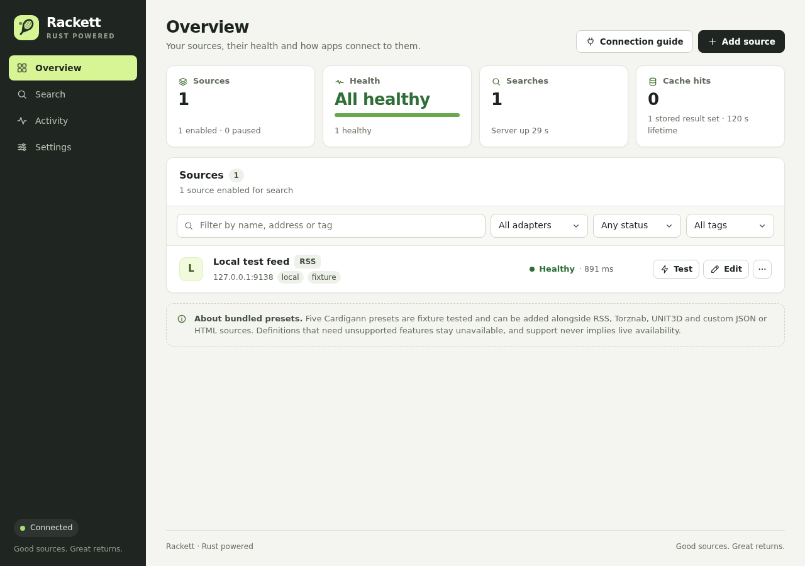

# Rackett

**Good sources. Great returns.** One search endpoint for all your torrent sites, written in Rust.



> **Status: early preview (0.1.0).** It works and is tested, but expect rough edges and
> missing features. See [Current limitations](#current-limitations).

## What is this?

Apps such as [Sonarr](https://sonarr.tv/) (TV) and [Radarr](https://radarr.video/)
(movies) find releases by searching torrent sites. Every site has its own website
layout, login and search format, so these apps don't talk to sites directly. They
talk to an **indexer proxy**: one service that knows how to search many sites and
returns the results in a single standard format called **Torznab**.

[Jackett](https://github.com/Jackett/Jackett) is the best-known indexer proxy. It
ships with hundreds of community-maintained site definitions, written in a YAML
format called **Cardigann**.

**Rackett is an independent indexer proxy built from scratch in Rust.** It reads
Jackett's Cardigann definitions and speaks the same Torznab API, so apps that work
with Jackett can work with Rackett. It aims to be:

- **Small and fast.** A single self-contained executable with a built-in web
  interface, a low memory footprint, and a result cache that answers repeat searches
  without contacting the site again.
- **Careful with your accounts.** Credentials stay on the server, never appear in
  errors or download links, and every request is held to strict time and size
  limits.
- **Honest about support.** A site is marked ready only after its definition passes
  an automated end-to-end test. Everything else is clearly labelled as unavailable,
  with the reason.

Rackett is not affiliated with the Jackett project.

## Quick start

You need [Rust](https://www.rust-lang.org/tools/install) (stable) to build Rackett.
Prebuilt binaries are not published yet.

```sh
git clone <this repository>
cd rackett
cargo build --release
./target/release/rackett --data-dir ./data
```

Then open **http://127.0.0.1:9117** in your browser.

Rackett uses Jackett's default port (9117) so it can replace it without
reconfiguring your apps. If Jackett is already running, pick another port with
`--port 9118`.

### 1. Add a source

Click **Add source** and choose one of these:

- **A bundled site.** The catalog includes all 583 site definitions from Jackett.
  Those marked *ready* can be used now; private sites ask for your own account
  details, such as a username and password, a cookie or an API key.
- **A custom source.** Connect anything that offers one of these:

  | Type | Use it for |
  | --- | --- |
  | RSS / Atom | Torrent feeds |
  | Torznab | Another Torznab service, including an existing Jackett |
  | UNIT3D | Sites running the UNIT3D tracker software (API key) |
  | JSON | A JSON search API, mapped field by field |
  | HTML | A web page, mapped with CSS selectors |

  See [custom source configuration](docs/adapters.md).

Use **Test** to confirm the source answers, then try a search on the **Search** page.

### 2. Connect your apps

Open **Connection guide** in Rackett to copy your Torznab URL and API key. The URL
looks like this:

```text
http://127.0.0.1:9117/api/v2.0/indexers/all/results/torznab/api
```

In Sonarr, Radarr or a similar app, go to **Settings → Indexers → Add → Torznab**
and paste the URL and API key. `all` searches every enabled source. Replace it with
a single source's ID to search just that one.

## Configuration

| Option | Environment variable | Default | Meaning |
| --- | --- | --- | --- |
| `--port PORT` | | `9117` | Port to listen on (always `127.0.0.1`) |
| `--data-dir PATH` | `RACKETT_DATA_DIR` | `./data` | Where settings and sessions are saved |
| `--public-url URL` | `RACKETT_PUBLIC_URL` | none | HTTPS address of a reverse proxy in front of Rackett |
| | `RACKETT_FLARESOLVERR_URL` | none | FlareSolverr endpoint for Cloudflare-protected sites |

Run `rackett --help` for the full list.

### Access from other devices

Rackett only listens on `127.0.0.1`. To reach it from elsewhere, put an HTTPS
reverse proxy in front of it, such as [Caddy](https://caddyserver.com/),
[Tailscale Serve](https://tailscale.com/kb/1312/serve) or nginx, and tell Rackett
the proxy's address:

```sh
rackett --public-url https://rackett.example.com
```

The URL must be an HTTPS origin with no path. Rackett uses it to build download
links and to check that settings changes come from your own interface.

### Cloudflare-protected sites

Some sites (for example 1337x and EZTV) sit behind a Cloudflare browser check. Run
[FlareSolverr](https://github.com/FlareSolverr/FlareSolverr) and point Rackett at it:

```sh
RACKETT_FLARESOLVERR_URL=http://localhost:8191/ rackett
```

See [FlareSolverr support](docs/flaresolverr-transport.md) for details.

### Run as a service (Linux)

[`packaging/rackett.service`](packaging/rackett.service) is a systemd user-service
template. Copy the binary to `~/.local/bin/rackett` and the template to
`~/.config/systemd/user/`, then run:

```sh
systemctl --user enable --now rackett
```

## Useful search options

- **`maxwait=2`** returns whatever sources have answered within two seconds. Slower
  sources keep running in the background and fill the cache for your next search.
- **Caching.** Results are cached per source. Once a result expires, Rackett serves
  it immediately and refreshes it in the background, for up to six hours by
  default. Both lifetimes can be changed in **Settings**.
- **Downloads** go through short-lived Rackett links, so your site credentials are
  never handed to other apps.

## Current limitations

- **Not every Jackett site works yet.** About half of the 583 bundled definitions
  are ready. The rest are listed with the feature they still need, for example
  CAPTCHA logins or some non-UTF-8 sites.
- **Fixture-tested, not live-tested.** Ready means the definition passes a complete
  automated test against a simulated copy of the site: login, search, caching,
  downloads and session expiry. It does not guarantee the real site is online or
  that your account works.
- **No Jackett settings import.** Sources must be added again in Rackett.
- **Linux is the only tested platform.** Windows and macOS builds are untested.
- **Torznab API only.** Rackett's own management API is different from Jackett's.

## For developers

```sh
cargo fmt --all -- --check
cargo clippy --locked --all-targets -- -D warnings
cargo test --locked
```

`tools/fixture_server.py` serves a fake RSS feed (`http://127.0.0.1:9138/feed`) for
trying the interface without touching real sites. `tools/release.sh` runs all checks
and builds a release archive in `dist/`.

[How Rackett works](docs/how-it-works.md) covers the code layout, how Cardigann
definitions are run, and how a site becomes *ready*.

## Acknowledgements

Rackett would not exist without [Jackett](https://github.com/Jackett/Jackett) and
the many people who write and maintain its tracker definitions. The 583 definitions
bundled in `vendor/jackett` are their work, used unchanged under GPL-2.0. If a site
definition is wrong or out of date, please fix it upstream in Jackett first.

## License

GPL-2.0-only. See [LICENSE](LICENSE) and [NOTICE](NOTICE). The bundled site
definitions in `vendor/jackett` come from the Jackett project, also GPL-2.0, and are
included unchanged with their checksums.

Use Rackett only with sites and content you are permitted to access.
